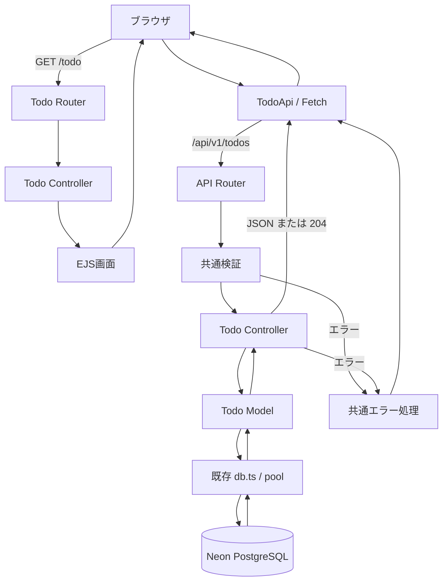
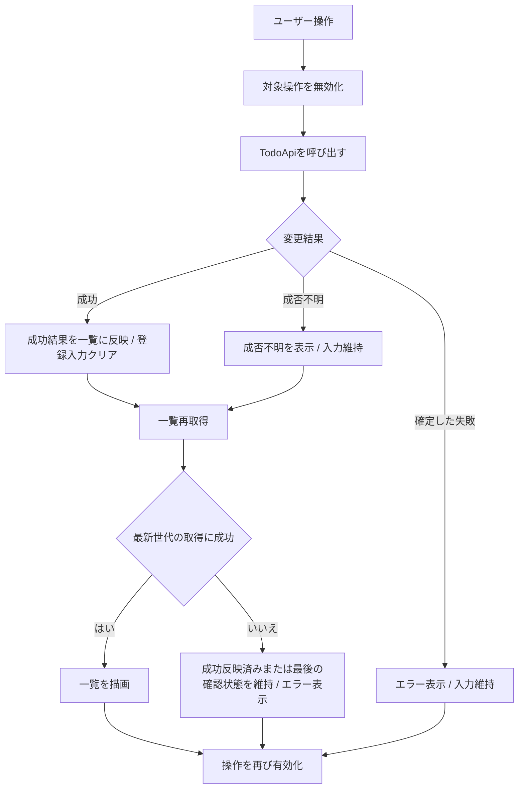

# TODOアプリ V1 設計書

状態：設計案（推奨方式・追加ファイル配置承認済み）  
対象：`feature/todo-app`  
参照：[`01_requirements.md`](./01_requirements.md)

## 1 作るものとファイルの役割

既存のExpress 5＋TypeScript＋EJSサイトに、TODO画面とREST APIを追加する。ブラウザ側はJavaScriptのFetch API、サーバー側はRouter・Controller・Modelで役割を分離し、既存の `db.ts` が公開する `pool` を共用する。認証・優先度・絞り込み・タイトル更新等はV1の対象外とする。

### ファイル構成（授業テキストに合わせた推奨配置）

下記は授業で提示された推奨構成であり、強制ではない。既存ファイルと新規候補を区別する。承認済みの追加ファイルも推奨構成に含める。実際の配置・設定を確認できていない箇所は要確認とする。

```text
プロジェクト直下/
├── index.ts
├── db.ts
├── package.json
├── tsconfig.json
├── public/todo/
│   ├── todo.js
│   ├── todoApi.js
│   └── todo.css
├── views/todo/
│   └── index.ejs
├── src/apps/todo/
│   ├── todoRouter.ts
│   ├── todoController.ts
│   ├── todoModel.ts
│   ├── todoValidator.ts
│   ├── todoTypes.ts
│   ├── todoError.ts
│   └── todoDb.ts
├── tests/todo/
├── docs/todo/
│   ├── 01_requirements.md
│   ├── 02_design.md
│   ├── 03_implementation_plan.md
│   ├── 04_test_results.md
│   └── v2/
└── sql/
    ├── README.md
    ├── 000_check_connection.sql
    ├── 010_setup_sample_products.sql
    └── todo/
        └── 020_create_todo_tasks.sql
```

`index.ts`、`db.ts`、`package.json`、`tsconfig.json`、`docs/todo/01_requirements.md` は既存リポジトリで確認済み。他は承認済みの新規作成予定または授業上の参考配置であり、現時点で存在することを確認したものではない。`010_setup_sample_products.sql` は第2回演習者のみが対象で、TODOの動作に依存させない。実装手順書・テスト結果書・発展課題は本書の作成対象外とする。

| ファイル（推奨配置） | 役割 |
| --- | --- |
| `index.ts` | Expressの起動と共通設定。TODO Routerの登録のみを追加することを原則とする。 |
| `db.ts` | 既存のPostgreSQL接続プール。新しいプールを作成しない。 |
| `src/apps/todo/todoRouter.ts` | URL、HTTPメソッド、ミドルウェアの適用順序、Controllerへの接続。 |
| `src/apps/todo/todoController.ts` | 入力検証の呼び出し、Modelの呼び出し、レスポンスの組み立て。 |
| `src/apps/todo/todoModel.ts` | SQL、DBトランザクション、取得した行の変換。HTTPやDOMには依存しない。 |
| `views/todo/index.ejs` | タイトル入力、一覧、状態・エラー領域のHTML。 |
| `public/todo/todo.js` | TodoApiの利用、イベント処理、画面描画、操作状態管理。 |
| `sql/todo/020_create_todo_tasks.sql` | TODOテーブル・制約・インデックスの作成SQL。手動適用用。 |

追加の責務と承認済みの推奨配置は以下のとおり。配置は強制ではなく、変更が必要な場合は理由を明示する。

| 責務 | 配置 |
| --- | --- |
| 入力検証 | `src/apps/todo/todoValidator.ts` |
| サーバー側型定義 | `src/apps/todo/todoTypes.ts` |
| APIエラー型・共通ミドルウェア | `src/apps/todo/todoError.ts` |
| DB期限管理・トランザクション補助 | `src/apps/todo/todoDb.ts` |
| TodoApiクラス | `public/todo/todoApi.js` |
| 素のCSS | `public/todo/todo.css` |
| 自動テスト | `tests/todo/` |
| Vercel設定ファイル | 要確認（既存設定・現在のデプロイ方式を確認し、必要な場合のみ追加） |

### index.tsへの変更

既存の `/`、`/api/db-check`、EJS設定、静的ファイル設定、ローカル起動を維持する。TODO RouterはAPIのフォーム形式を先に解析させないため、既存の `express.urlencoded()` の登録より前にマウントする。EJS設定は従来どおりサーバー起動前に完了させる。

追記例（推奨配置に従う場合の差分イメージ）：

```typescript
import todoRouter from './src/apps/todo/todoRouter';
```

```typescript
app.use(todoRouter);
```

`todoRouter` の内部に画面用ルートとAPI用のサブRouterを持たせる。TODO固有のJSON解析、エラー処理はAPI用サブRouterに閉じ込める。既存コードの不要な整形・移動や全体的な再構成は行わない。Vercelで追加修正が必要な場合は理由を明示し、最小限にする。

## 2 リクエストはどこを通るか

画面へのGETはHTMLを返し、TODOデータの取得・変更はAPIを通る。画面の初期HTMLにはTODOデータを埋め込まない。



| リクエスト | 処理先 | 結果 |
| --- | --- | --- |
| `GET /todo` | 画面用Controller | `todo/index` をEJSでレンダリング |
| `GET /api/v1/todos` | 一覧Controller | 200 JSON |
| `POST /api/v1/todos` | 登録Controller | 201 JSON |
| `PATCH /api/v1/todos/:id` | 完了状態更新Controller | 200 JSON |
| `DELETE /api/v1/todos/:id` | 削除Controller | 204、本文なし |
| `HEAD /api/v1/todos` | 一覧Controller相当 | GET相当のステータス・ヘッダー、本文なし |
| `OPTIONS /api/v1/todos`・`OPTIONS /api/v1/todos/:id` | API Router | 204、Allow、本文なし |

`/api/v1/todos` をAPIサブRouterの境界とし、その配下だけで未定義パス404、未対応メソッド405を処理する。既存ルートにはTODO用のエラー形式を適用しない。

## 3 DBの設計

### テーブル定義

テーブル名は `todos`。PostgreSQLの既存データベースを利用する。

| カラム | 型 | 制約・初期値 |
| --- | --- | --- |
| `id` | INTEGER | PRIMARY KEY、IDENTITY、1以上、採番上限2,147,483,647、再利用なし |
| `title` | VARCHAR(100) | NOT NULL、1〜100文字、同名可 |
| `completed` | BOOLEAN | NOT NULL、DEFAULT FALSE |
| `created_at` | TIMESTAMPTZ(3) | NOT NULL、DEFAULT CURRENT_TIMESTAMP(3) |
| `updated_at` | TIMESTAMPTZ(3) | NOT NULL、DEFAULT CURRENT_TIMESTAMP(3) |

作成SQL案（実行前に対象DB・同名テーブルの有無を確認する）：

```sql
BEGIN;

CREATE TABLE todos (
    id INTEGER GENERATED ALWAYS AS IDENTITY (NO CYCLE) PRIMARY KEY,
    title VARCHAR(100) NOT NULL,
    completed BOOLEAN NOT NULL DEFAULT FALSE,
    created_at TIMESTAMPTZ(3) NOT NULL DEFAULT CURRENT_TIMESTAMP(3),
    updated_at TIMESTAMPTZ(3) NOT NULL DEFAULT CURRENT_TIMESTAMP(3),
    CONSTRAINT todos_id_positive CHECK (id >= 1),
    CONSTRAINT todos_title_length CHECK (char_length(title) BETWEEN 1 AND 100),
    CONSTRAINT todos_title_no_breaks CHECK (
        position(chr(10) in title) = 0
        AND position(chr(13) in title) = 0
        AND position(chr(9) in title) = 0
    )
);

CREATE INDEX todos_created_at_id_idx
    ON todos (created_at DESC, id DESC);

COMMIT;
```

`trim()`、孤立サロゲート、NUL等の検証はサーバーで行う。DBの文字数制約は補助とし、JavaScriptの空白除去とUnicode検証を代用しない。日時はDBで生成し、JSONへ変換する際はISO 8601のUTC文字列（ミリ秒精度）にする。採番の欠番は許容し、シーケンスをリセット・循環させない。

SQLは手動で適用する。起動時のCREATE、DROP、TRUNCATE、データ初期化は禁止する。同名テーブルが存在する場合は定義を照合し、誤って上書きしない。PreviewとProductionで同じDBを使うため、変更時は既存バージョンとの互換性を維持する。

### 登録件数の上限と同時実行

最大1,000件は完了済みを含む `todos` の現在件数とする。POSTの件数確認とINSERTを、同じプールクライアント上のREAD COMMITTEDトランザクションで実行する。件数確認前に `SHARE ROW EXCLUSIVE` のテーブルロックを取得し、他の登録・更新・削除と競合する場合は待機させる。通常のSELECTは妨げない。上限到達時はROLLBACKして409を返す。

PATCH・DELETEは対象行の変更を単一SQLで行う。競合時はDBの行ロックによって処理順が決まり、削除済みの行を挿入し直さない。すべての変更はCOMMIT成功後に成功応答を返す。DBエラー時はROLLBACKし、クライアントを必ず解放する（状態不明・接続破損時は破棄する）。

## 4 APIの共通ルール

### データ形式

TODOのJSONは常に次の5項目を返す。DBの行型とAPI用の型は分け、日時を文字列に変換する。

```typescript
interface Todo {
    id: number;
    title: string;
    completed: boolean;
    created_at: string;
    updated_at: string;
}

interface CreateTodoInput {
    title: string;
}

interface UpdateTodoInput {
    completed: boolean;
}

interface ApiSuccess<T> {
    data: T;
}

interface ApiErrorBody {
    error: {
        code: string;
        message: string;
    };
}
```

上記の型は原則として `todoTypes.ts` に定義する。

### 成功・ヘッダー

GETは `data: Todo[]`、POST・PATCHは `data: Todo`。JSONを返す場合は `Content-Type: application/json`、一覧は `Cache-Control: no-store` としてブラウザ側も `cache: 'no-store'` を指定する。条件付きGETによる304を返さないよう、TODO一覧の自動ETag／鮮度判定の挙動を確認する。既存サイトのキャッシュ設定を一律に変更しない。DELETE、HEAD、OPTIONSには本文を付けない。

| APIパス | Allow |
| --- | --- |
| `/api/v1/todos` | `GET, POST, HEAD, OPTIONS` |
| `/api/v1/todos/:id` | `PATCH, DELETE, OPTIONS` |

OPTIONS・405ではAllowを返す。他オリジンのCORS許可ヘッダーは追加しない。

### 入力検証と処理順

定義済みのパス・HTTPメソッドについて、適用される条件のみを次の順に検証する。失敗時はDBを操作しない。

1. Content-Type：POST・PATCHはメディアタイプが `application/json` の場合のみ許可する。ヘッダー欠落・不一致は415。文字コードはUTF-8のみとし、charset省略またはUTF-8指定を許可する。他のcharsetおよび圧縮されたリクエスト本文は415とする。
2. 本文サイズ：POST・PATCHは8,192バイト以下。超過は413。
3. JSON構文：空本文・構文不正は400。JSONのnull、配列、数値等は構文解析自体では拒否せず、入力値検証で422とする。
4. ID：該当するパスでは `/^[1-9][0-9]*$/` に一致し、2,147,483,647以下か確認する。不正時400。
5. クエリ：V1では定義済みのクエリパラメータがないため、指定されていれば400。
6. 入力値：JSONオブジェクトのみ許可し、POSTは `title`、PATCHは `completed` のみ必須とする。欠落、型違い、余分なキー、禁止文字は422。
7. DB処理：存在、件数上限、競合、DB障害等を扱う。

ExpressのJSON解析はTODO APIのPOST・PATCHに限定する。`express.raw({ type: 'application/json', limit: 8192, inflate: false })` で読み取り、UTF-8デコードと `JSON.parse()` を実行する。これにより空本文、構文不正、配列・プリミティブ値を区別する。UTF-8のデコードは不正なバイト列を置換せず検出し、400とする。圧縮本文は415で拒否する。GET・DELETE・HEAD・OPTIONSの本文は解析せず、操作の入力として使用しない。既存の `express.urlencoded()` で先に解析しない。

タイトルは文字列型を確認後、`trim()` で前後の空白を除去する。`Array.from(title).length` でUnicodeコードポイント数を確認し、1〜100文字以外を拒否する。NULや孤立サロゲート、除去後に残る改行・タブを拒否し、Unicode正規化はしない。HTMLタグは文字列のまま受け付ける。完了状態は真偽値のみ許可し、文字列や数値を真偽値へ暗黙変換しない。

### タイムアウト

| 層 | 上限 | 方針 |
| --- | --- | --- |
| DB | 接続待ち＋処理の合計20秒 | 接続取得・ロック待ち・SQL・COMMITまで共通の期限を管理する。 |
| サーバー | 25秒 | API処理の終了期限。制御可能なタイムアウトは503。 |
| ブラウザ | 30秒 | AbortControllerを使い、応答本文の読取まで含めて中断する。 |

DBは既存poolを利用する。`connectionTimeoutMillis` の必要な最小変更と、DB処理用の残り時間に応じたタイムアウトを組み合わせる。各SQLに一律20秒を設定するだけでは合計20秒を超えるため、同一の期限から残り時間を算出する。トランザクション内で残り時間に応じた `statement_timeout` 等を設定し、ロック待ちも対象とする。通信断などで処理結果を確認できない場合は接続を破棄し、未確定トランザクションを終了させる。期限後のCOMMIT開始、二重応答、破損クライアントの再利用を防ぐ。

`Promise.race()` で応答だけ終了させ、SQLを実行し続ける実装は禁止する。ROLLBACK・接続解放を行い、既にCOMMITされた変更は取り消せないものとする。期限管理とトランザクション補助は `todoDb.ts` に分離する。Vercelの関数実行時間設定は要確認。Vercel自身の504や通信断は共通JSON形式を保証しない。

## 5.1 REQ-01 TODO一覧を取得する

**API：** `GET /api/v1/todos`。入力なし。Controllerは共通検証後、Modelの一覧取得を実行する。

```sql
SELECT id, title, completed, created_at, updated_at
FROM todos
ORDER BY created_at DESC, id DESC;
```

200で以下の形式を返す。0件時は `{"data": []}` とし、404にはしない。

```json
{
    "data": [
        {
            "id": 1,
            "title": "架空の課題を確認する",
            "completed": false,
            "created_at": "2026-01-01T00:00:00.000Z",
            "updated_at": "2026-01-01T00:00:00.000Z"
        }
    ]
}
```

画面には取得中・0件・一覧・取得失敗を区別して表示する。HEADは同等の処理を行うが本文は返さない。確認対象は並び順、同一日時のID順、空配列、キャッシュ、DB障害、取得中表示とする。

## 5.2 REQ-02 TODOを登録する

**API：** `POST /api/v1/todos`。

```json
{
    "title": "架空の課題を確認する"
}
```

Controllerは入力検証済みのタイトルをModelへ渡す。Modelは次の順に同一クライアントでトランザクションを実行する。SQLは実行単位ごとに分け、期限管理を適用する。

```sql
BEGIN ISOLATION LEVEL READ COMMITTED;
```

```sql
LOCK TABLE todos IN SHARE ROW EXCLUSIVE MODE;
```

```sql
SELECT COUNT(*)::integer AS count FROM todos;
```

件数が1,000件以上ならROLLBACKして409。未満なら次のSQLを実行する。

```sql
INSERT INTO todos (title)
VALUES ($1)
RETURNING id, title, completed, created_at, updated_at;
```

```sql
COMMIT;
```

`$1` は検証・trim済みタイトル。ID、完了状態、日時はDBの初期値を利用する。201の `data` は登録されたTODOオブジェクトとする。画面は登録成功時に入力欄をクリアし、一覧を再取得する。失敗時は入力を維持する。ID枯渇は500、上限は409、入力エラー等は共通ルールに従う。確認対象は文字数、Unicode、空白、同名、登録時日時の一致、999件からの同時登録、1,000件到達、削除後の再登録、ID枯渇とする。

## 5.3 REQ-03 完了状態を変える

**API：** `PATCH /api/v1/todos/:id`。

```json
{
    "completed": true
}
```

ControllerはIDと真偽値を検証し、Modelへ渡す。Modelは変更と取得を別々にせず、次の単一SQLを実行する（共通期限管理・トランザクション内）。

```sql
UPDATE todos
SET completed = $2,
    updated_at = CASE
        WHEN completed IS DISTINCT FROM $2 THEN clock_timestamp()
        ELSE updated_at
    END
WHERE id = $1
RETURNING id, title, completed, created_at, updated_at;
```

`$1` はID、`$2` は真偽値。結果が0行なら404、1行ならCOMMIT後200で更新後TODOを返す。同一状態の再指定は200で更新日時不変。タイトルは変更しない。競合時はDBへの反映順を優先し、削除が先なら404とする。ミリ秒精度のため時間差が同一ミリ秒の場合もあり、状態が変わるテストでは時刻精度を考慮する。画面は処理中の対象操作を無効化し、失敗時は以前の表示を維持する。確認対象は双方向変更、同一状態、タイトル不変、404、競合更新・削除とする。

## 5.4 REQ-04 TODOを削除する

**API：** `DELETE /api/v1/todos/:id`。本文不要。

画面で確認ダイアログを表示し、承認された場合のみAPIを呼ぶ。ControllerはIDを検証してModelへ渡す。

```sql
DELETE FROM todos
WHERE id = $1
RETURNING id;
```

結果が0行なら404、1行ならCOMMIT後に204を返す。`res.status(204).end()` とし、JSONを返さない。削除成功後は一覧を再取得する。削除済みIDは再利用しない。確認対象は確認・キャンセル、204の空本文、他行への影響なし、再削除404、削除と更新の競合とする。

## 6 画面とTodoApiの設計

### 画面構成

```text
┌─────────────────────────────────────┐
│ TODO一覧                            │
│ [タイトル入力欄          ] [登録]  │
│ 読み込み中／エラー／0件案内         │
│ [ ] 架空の課題A             [削除]  │
│ [✓] 架空の課題B             [削除]  │
└─────────────────────────────────────┘
```

EJSは画面骨格を構築する。入力欄にはラベルを付け、登録はフォーム送信（Enterキーでも操作可）で処理する。完了状態はチェックボックスと取り消し線の両方で表し、削除は `window.confirm()` を使用する。エラー領域・読み込み領域はスクリーンリーダーに状態が伝わるようにし、色だけで完了を区別しない。CSSは `public/todo/todo.css` に記述する素のCSSとし、スマートフォンでも横スクロールせず操作できるようにする。表示文言の組み立てには `textContent` 等の安全なDOM操作を使い、タイトルを `innerHTML` に挿入しない。

### TodoApiクラス

インスタンスメソッドでHTTP通信を担当し、DOMを直接操作しない。`public/todo/todoApi.js` にES moduleとして分離して名前付きexportし、`todo.js` からimportする。EJSでは `todo.js` を `type="module"` で読み込む。以下はインターフェース案であり、JavaScriptで実装する（型は説明用）。

| メソッド | 引数 | 戻り値（Promise） |
| --- | --- | --- |
| `list()` | なし | `Todo[]` |
| `create(title)` | 文字列 | `Todo` |
| `updateCompleted(id, completed)` | 整数、真偽値 | `Todo` |
| `remove(id)` | 整数 | `void` |
| `request(method, path, body)` | 内部用 | JSONのdata、または204時は値なし |

ベースURLは同一オリジンの `/api/v1/todos`。POST・PATCHはJSONを送信する。`response.ok` と期待ステータス・レスポンス構造を確認し、DELETEの204はJSON解析しない。エラー時は安全な表示用メッセージ、HTTPステータス、エラーコード、変更の成否が不明かどうかを画面側へ伝える。非JSON応答や通信失敗にも対応する。変更系の自動再試行は行わない。

### 画面状態／応答競合

初回ロードは `list()` を呼び出す。登録・更新・削除の成功後にも一覧を再取得する。登録処理中は入力欄・登録ボタンを無効化し、同じTODOに対する更新と削除も同時に操作できないようにする。チェックボックスは処理確定まで従来状態を維持する（失敗時は元の値に戻す）。通信終了時は `finally` でロックを解除する。

画面側で最後に確定した一覧と取得の世代番号を管理する。新しい変更の開始・完了で古い取得世代を無効にし、最新世代の取得結果だけを描画する。複数の変更が重なった場合は、最後の変更終了後に再取得して確定状態を反映する。古い応答のデータやエラーで新しい表示状態を上書きしない。

変更APIが成功した場合は、登録・更新では返されたTODOを該当IDの行に追加・反映し、削除では対象IDの行を除去したうえで、一覧を再取得する。再取得に失敗した場合は、変更APIの成功結果を反映した一覧を維持し、最新の全件状態を確認できなかった旨を表示する。登録・削除・更新の結果が競合する場合は古い応答を適用せず、最新世代の一覧取得を優先する。通信断・タイムアウト・非JSON応答などで変更結果が不明の場合は、入力を保持して一覧を再取得する。再取得失敗時は最後に取得できた一覧を維持する。リアルタイム同期は行わない。



## 7 エラーはどこで処理するか

| エラー | コード | 主な発生箇所 |
| --- | --- | --- |
| 400 | `BAD_REQUEST` | API Router／Validator：空本文、JSON不正、ID不正、未定義クエリ |
| 404 | `NOT_FOUND` | API Router：未定義パス／Controller・Model：対象なし |
| 405 | `METHOD_NOT_ALLOWED` | API Router：未対応メソッド、Allowを付与 |
| 409 | `LIMIT_EXCEEDED` | Model：登録上限 |
| 413 | `PAYLOAD_TOO_LARGE` | 本文解析ミドルウェア：8KiB超過 |
| 415 | `UNSUPPORTED_MEDIA_TYPE` | Content-Type検証 |
| 422 | `VALIDATION_ERROR` | Validator：入力条件違反 |
| 500 | `INTERNAL_SERVER_ERROR` | 予期しない内部エラー、ID枯渇 |
| 503 | `SERVICE_UNAVAILABLE` | DB接続障害、DB・サーバーの制御可能なタイムアウト |

```json
{
    "error": {
        "code": "VALIDATION_ERROR",
        "message": "入力値が不正です"
    }
}
```

ModelはDBのエラーを分類し、Controller・Validatorは共通エラー型（HTTPステータス、コード、公開可能なメッセージ）を使用する。APIサブRouter末尾の4引数エラーミドルウェアでJSON応答に統一する。Express 5のasyncハンドラーから返された拒否はエラーミドルウェアへ渡す。HEADの場合はエラーも本文なしとする。送信済みの応答に再度JSONを送信しない。

DB障害は接続系のSQLSTATE、接続断、接続取得失敗、期限に起因するクエリ中断等を基に判定する。例えばSQLSTATE `2200H` はシーケンス上限、`08` 系は接続障害である。権限不足やSQL構文不正等を無条件に503とせず500へ分類する。本文解析の413・400・415等はミドルウェアが返すエラー種別から変換し、スタックや生のDBメッセージ、リクエスト本文を公開しない。

サーバーログはconsoleを使い、発生日時、HTTPメソッド、パス、エラーコードを記録する。クエリの値、DB接続文字列や生のエラー本文など秘密情報を含み得る内容を記録しない。ブラウザでは共通JSON以外のエラーも処理し、安全なテキストで表示する。明確な入力エラーと、DB変更が確定したか分からない障害を区別する。

## 8 実装への注意事項

### 既存コード・ビルド・公開

- `index.ts` への追加はRouter登録を中心に最小化し、既存の `/` と `/api/db-check` のレスポンス・実行方法を維持する。
- `db.ts` の既存poolを共用し、環境に合わせた接続情報は `DATABASE_URL` から取得する。未設定なら起動エラーとする。接続数上限2の既存設定は原則維持し、必要なタイムアウト設定だけを追加する。
- `tsconfig.json` は現状 `include: ["index.ts"]`。index.tsからimportされるTypeScriptをビルド対象にできることを確認する。テストファイルは `tests/todo/` に配置する。テスト用の追加ビルド設定が必要かは実装時に確認する。ブラウザのJavaScriptはpublic配下に置き、TypeScriptビルドの対象にしない。
- Vercelではpublic配下を静的ファイルとして配信する。EJSテンプレートがデプロイ成果物に含まれること、`/todo` のHTMLとJS/CSSが両環境で読み込まれること、関数の実行上限がサーバー側25秒を妨げないことを確認する。Vercel固有設定は現状を確認してから最小変更する。
- `.env` とDB情報をコミットしない。他オリジンのCORS許可を追加しない。無認証のため第三者の直接操作を防げないことを前提とし、架空のデータのみ扱う。
- パラメータ化SQLを使用する。トランザクション・エラー・期限処理は例外時も接続を解放し、同時登録や更新でデータ整合性を壊さない。コードのインデントは新規部分でスペース4つとする。

### テスト設計

自動テストはNode.js標準の `node:test` を使用し、TypeScript実行には既存のtsxを利用する。APIテストはテスト専用ExpressアプリにTODO Routerをマウントする方式を候補とし、既存index.tsの起動副作用を避ける。実アプリも別途起動して既存ルート・画面を確認する。DB接続先はPreview・Productionの共有DBから分離したテスト専用Neon DBとし、各テストが実行順に依存しないよう準備・後処理を行う。テストコードは `tests/todo/` に配置する。実際のテスト専用Neon DBの準備状況は要確認とし、分離を確認できない状態で破壊的なテストを実行しない。

| 対象 | 自動・手動確認項目 |
| --- | --- |
| REQ-01 | 200、0件、登録日時・ID降順、HEAD、no-store、条件付きGET、503・500 |
| REQ-02 | 201、trim、Unicode境界値、同名、禁止文字、型、日時、409、999件からの競合登録、ID枯渇 |
| REQ-03 | 双方向、同一状態、日時、ID境界値、タイトル変更拒否、404、競合更新・削除 |
| REQ-04 | 204空本文、他の行の維持、存在しないID、再削除404、ID非再利用 |
| 共通 | 空本文、JSON構文、オブジェクト以外、8,192/8,193バイト、415、未定義クエリ、エラー順序、404/405/OPTIONS/Allow、SQL注入対策、期限・接続解放、ログ、起動時のデータ維持 |
| 画面（手動） | 初回取得、入力・登録・更新・削除、キャンセル、エラー時入力保持、無効化、非JSONエラー、通信断後の再取得、応答競合、XSS対策、PC・スマートフォン、キーボード操作 |
| 公開（手動） | Local/Preview/Production、既存ルート、ビルド、DB共有・互換性、アセット読み込み、確認データのみ削除 |

Localで `npm ci`、`npm run dev`、`npm run build` と自動テストを確認する。異常系・上限・ID枯渇テストは分離DBで行う。Previewで受け入れ条件と自動テスト成功を確認してからProductionへ公開し、Productionの正常系と共有DBの確認を行う。最終的な結果は `04_test_results.md` に記録する。

### 環境の要確認事項

1. Vercelの実際の設定、デプロイ方式、関数実行時間上限およびEJS・publicの配信状況。必要な設定ファイルの配置は現状確認後に決定する。
2. Preview・Productionから分離されたテスト専用Neon DBの準備状況。接続情報そのものは設計書に記載しない。

追加ファイルの推奨配置、本文処理、変更成功後の一覧再取得失敗時の扱い、テスト用DBの方式は承認済み。上記は環境の実態確認事項として残す。要件定義書の変更、SQLの実行、実装、デプロイは行わない。

### 技術資料

- [Express 5 API](https://expressjs.com/en/5x/api/express/)
- [Express 5 Error Handling](https://expressjs.com/en/5x/guide/error-handling/)
- [body-parser middleware](https://expressjs.com/en/resources/middleware/body-parser/)
- [PostgreSQL LOCK](https://www.postgresql.org/docs/current/sql-lock.html)
- [PostgreSQL Explicit Locking](https://www.postgresql.org/docs/current/explicit-locking.html)
- [node-postgres Client API](https://node-postgres.com/apis/client)
- [node-postgres Pool API](https://node-postgres.com/apis/pool)
- [Express on Vercel](https://vercel.com/docs/frameworks/backend/express)
